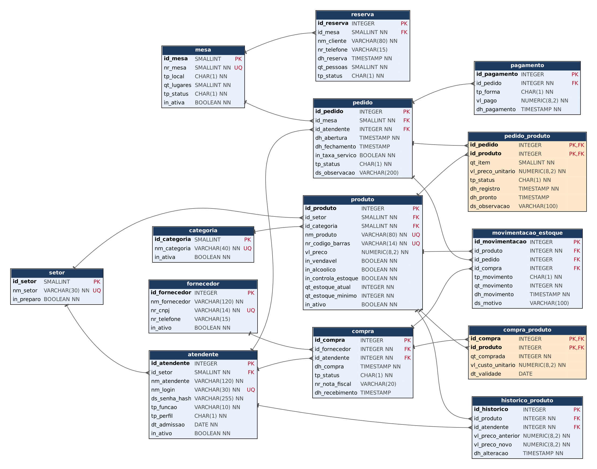

# Palazio del Chef — Relatório Técnico (Entrega 2)

**Disciplina:** Modelagem de Banco de Dados · UNICID · Prof. Cid Andrade
**Grupo:** Victor Sousa dos Anjos, Thiago Rodrigues Ribeiro, Ricardo Santos Marcelino, Raphael Luiz Lima de Araujo
**Organização real:** Palazio del Chef (restaurante e bar), Rua Apucarana, 480, Tatuapé, São Paulo
**SGBD:** PostgreSQL 16 · **Banco:** `palazio_del_chef`

> Este relatório continua a Entrega 1 (README da raiz do repositório). O modelo conceitual (DER de Chen, 12 entidades e 16 relacionamentos) e o dicionário de dados estão lá; aqui eles são revistos, convertidos em modelo lógico relacional e implementados em SQL.
> Os itens marcados `[VALIDAR]` dependem de confirmação do grupo ou do professor.

## Sumário
1. Revisão do modelo conceitual
2. Conversão do conceitual para o lógico
3. Chaves primárias e estrangeiras
4. Normalização (1FN, 2FN, 3FN)
5. Justificativas técnicas
6. Arquitetura analítica (BI e IA)
7. Modelo lógico relacional (diagrama)
8. Scripts SQL e como executar
9. Massa de dados fictícia
10. Testes e evidências
11. Uso de IA nesta entrega
12. Limitações e pontos para validar

---

## 1. Revisão do modelo conceitual

O DER da Entrega 1 foi mantido. Foram feitos **três ajustes**, todos nascidos de problemas encontrados ao implementar:

| # | Ajuste | Motivo |
|---|---|---|
| 1 | Novo atributo `IN_CONTROLA_ESTOQUE` em PRODUTO (`[VALIDAR]`) | Nem todo produto tem estoque por unidade. Cerveja, refrigerante, água, vinho, sobremesa pronta e insumo têm; o controle do que chega ao local é feito pelos garçons. Prato, pizza, drink e café preparados na hora não têm baixa por porção; o consumo dos ingredientes é lançado à mão (baixa manual de insumos, informada pelo estabelecimento). Sem o atributo, o estoque de um prato ficaria sempre zero e a regra "estoque nunca negativo" bloquearia vendas. Dicionário, DER e HTML foram atualizados. |
| 2 | Chaves compostas nos relacionamentos N:N CONTÉM e POSSUI | Mantém a orientação do professor de **não ter a entidade Item_pedido**. Os atributos do relacionamento (quantidade, preço unitário, status, horários) viram colunas da tabela associativa, com chave `(id_pedido, id_produto)`. |
| 3 | `TP_FUNCAO` e `TP_LOCAL` detalhados como domínios | Função do funcionário (garçom, caixa, cozinha, bar, gerente, sócio, limpeza) e local (mesa `M` ou bistrô `B`) viraram `CHECK`. |

Consequência assumida do ajuste 2 (para validar com o professor): **o mesmo produto não se repete em um pedido**. Pedir de novo soma a quantidade da linha existente (função `lancar_item`), e o status (pendente, em preparo, pronto, entregue, cancelado) é **por produto**, não por unidade.

## 2. Conversão do conceitual para o lógico

Regras aplicadas:

| Construção do DER | Tabela/coluna resultante |
|---|---|
| Entidade | Uma tabela. Atributo identificador vira PK. |
| Relacionamento 1:N | FK na tabela do lado N. |
| Relacionamento N:N com atributos (CONTÉM, POSSUI) | Tabela associativa com PK composta e FKs para as duas entidades. |
| Atributo opcional | Coluna que aceita `NULL` (`dh_fechamento`, `dh_pronto`, `nr_telefone`, `dt_validade`...). |
| Domínio fechado (`TP_*`, `IN_*`) | `CHAR` ou `BOOLEAN` com `CHECK`. |
| Atributo derivado (total do pedido, taxa de 10%, saldo) | **Não é coluna.** Vira view (`vw_pedido_total`) e função (`fn_total_pedido`). |
| Prefixos do dicionário | Mantidos em minúsculas: `id_`, `nm_`, `dt_`, `dh_`, `qt_`, `vl_`, `nr_`, `tp_`, `in_`, `ds_`. |

Resultado: **14 tabelas** (12 entidades + `pedido_produto` + `compra_produto`) e **18 chaves estrangeiras**.

| Tabela | Origem no DER | Linhas na carga |
|---|---|---|
| setor | entidade SETOR | 5 |
| categoria | entidade CATEGORIA | 11 |
| atendente | entidade ATENDENTE | 15 |
| mesa | entidade MESA | 55 (30 mesas + 25 bistrôs) |
| reserva | entidade RESERVA | 14 |
| produto | entidade PRODUTO | 62 (54 do cardápio + 8 insumos) |
| historico_produto | entidade HISTORICO_PRODUTO | 8 |
| pedido | entidade PEDIDO | 1.649 |
| pedido_produto | relacionamento CONTÉM | 5.936 |
| pagamento | entidade PAGAMENTO | 1.933 |
| fornecedor | entidade FORNECEDOR | 6 |
| compra | entidade COMPRA | 11 |
| compra_produto | relacionamento POSSUI | 36 |
| movimentacao_estoque | entidade MOVIMENTACAO_ESTOQUE | 1.720 |

## 3. Chaves primárias e estrangeiras

**Chaves primárias.** Substitutas (`INTEGER`/`SMALLINT GENERATED BY DEFAULT AS IDENTITY`) em todas as entidades. Compostas apenas em `pedido_produto (id_pedido, id_produto)` e `compra_produto (id_compra, id_produto)`. Identificadores naturais (`nm_login`, `nr_cnpj`, `nr_codigo_barras`, `nr_mesa`, `nm_produto`) ficam como `UNIQUE`.

**Chaves estrangeiras** (todas `NOT NULL`, exceto as duas de origem em `movimentacao_estoque`):

| Filha | Coluna | Pai | Cardinalidade |
|---|---|---|---|
| atendente | id_setor | setor | N:1 |
| produto | id_setor, id_categoria | setor, categoria | N:1 |
| historico_produto | id_produto, id_atendente | produto, atendente | N:1 |
| reserva | id_mesa | mesa | N:1 |
| pedido | id_mesa, id_atendente | mesa, atendente | N:1 |
| pedido_produto | id_pedido, id_produto | pedido, produto | N:1 (PK composta) |
| pagamento | id_pedido | pedido | N:1 |
| compra | id_fornecedor, id_atendente | fornecedor, atendente | N:1 |
| compra_produto | id_compra, id_produto | compra, produto | N:1 (PK composta) |
| movimentacao_estoque | id_produto; id_pedido ou id_compra (um dos dois, conforme o tipo) | produto, pedido, compra | N:1 |

Sem `ON DELETE CASCADE`: o histórico de um restaurante não deve sumir em cascata. Exclusões são tratadas por trigger (seção 5).

## 4. Normalização

**1FN.** Todas as colunas são atômicas (sem listas nem grupos repetidos). Itens do pedido e itens da compra estão em tabelas próprias, não em colunas como "produto1, produto2". Cada tabela tem PK.

**2FN.** Nas tabelas de PK composta, todo atributo depende da chave inteira:
- `pedido_produto`: `qt_item`, `vl_preco_unitario`, `tp_status`, `dh_registro`, `dh_pronto`, `ds_observacao` dependem de **(pedido, produto)**. O nome e o preço de tabela do produto ficam em `produto`, não aqui.
- `compra_produto`: `qt_comprada`, `vl_custo_unitario`, `dt_validade` dependem de **(compra, produto)**.
- As demais tabelas têm PK simples, então não há dependência parcial.

**3FN.** Nenhum atributo não-chave depende de outro não-chave:
- Nome do setor e da categoria não se repetem em `produto`: ficam em `setor` e `categoria`.
- Dados do garçom não se repetem em `pedido`: só a FK.
- **Total do pedido, taxa de serviço e saldo não são armazenados.** Dependem dos itens e do indicador `in_taxa_servico` e são calculados na view `vw_pedido_total`.

**Redundâncias deliberadas** (e como o banco as protege):

| Redundância | Por que existe | Proteção |
|---|---|---|
| `produto.qt_estoque_atual` (saldo = soma das movimentações) | Consulta rápida do estoque no salão | Só o trigger `trg_mov_after` altera o saldo; o painel de auditoria **A6** confere saldo = soma das movimentações |
| `pedido_produto.vl_preco_unitario` | O preço no momento da venda não pode mudar quando o cardápio mudar (RN07) | Trigger copia o preço do cardápio e impede alteração; auditoria **A8** compara com o histórico de preços |
| `mesa.tp_status` | Mapa de mesas em tempo real | Atualizado pelos triggers de pedido; auditoria **A5** confere com os pedidos abertos |

## 5. Justificativas técnicas

**Regras de negócio no banco.** As regras do levantamento (README, seção 4) foram implementadas em `03_triggers_views.sql`, para valer mesmo que o app Garçom Web ou outra ferramenta acesse o banco. São 27 triggers:

| Regra (README, seção 4) | Implementação |
|---|---|
| RN01 pedido com atendente; RN02 pedido com mesa | FKs `NOT NULL` em `pedido` |
| RN03 código de barras único | `UNIQUE` + `CHECK` em `produto` |
| RN04 só atendente ativo abre pedido | `trg_pedido_ins` |
| RN05 um pedido aberto por mesa | `trg_pedido_ins` + índice único parcial `ux_pedido_mesa_aberto` |
| RN06 item vai ao setor de preparo do produto | `trg_produto_setor` (produto vendável só em setor de preparo) |
| RN07 preço congelado no item | `trg_pp_before` copia o preço e impede alteração |
| RN08 estoque suficiente / nunca negativo | `trg_pp_before`, `trg_mov_before` e `CHECK` |
| RN09/RN17 cancelar item só antes de ficar pronto | matriz de transições em `trg_pp_before` |
| RN10 fechar só pago e sem itens pendentes | `trg_pedido_upd` |
| RN11 total calculado | view `vw_pedido_total` e `fn_total_pedido` |
| RN12 login único | `UNIQUE (nm_login)` |
| RN13 cadastros não são excluídos | `trg_bloqueia_exclusao` |
| RN14 produto indisponível não é pedido | `trg_pp_before` |
| RN15 pagamento dividido, sem exceder a conta | `trg_pagamento_ins` |
| RN16 taxa de 10% removível | `in_taxa_servico` + `vw_pedido_total` |
| RN21 saldo = soma das movimentações | `trg_mov_after` (única porta de alteração do saldo) |
| RN30 insumo com estoque e fora do cardápio | `CHECK ck_produto_insumo` |
| Proposta desta entrega: só gerência/sócio muda preço (com histórico), registra compra e faz ajuste de estoque | `trg_produto_preco`, `trg_compra_ins`, `trg_mov_before` |
| Histórico imutável | `trg_somente_insercao` (pagamento, movimentação, histórico) |

**Quem fez a operação.** O app informa o usuário com `SET LOCAL app.id_atendente = 'id'` na transação. O banco confere o perfil (A atendimento, P preparo, G gerência, S sócio). Item só vai para "em preparo/pronto" por quem é do setor do produto (ou gerência), e só gerência/sócio faz ajuste manual de estoque ou muda preço.

**Concorrência.** `pedido_produto` e `mesa` são lidas com `FOR UPDATE` onde há decisão (abertura de pedido, lançamento de item), evitando duas aberturas simultâneas na mesma mesa. O índice único parcial é a garantia final.

**Índices.** Além das PKs e `UNIQUE`: fila de preparo (`ix_pp_fila`, parcial em itens pendentes/em preparo), fechamento do caixa por data (`ix_pagamento_data`), extrato de estoque (`ix_mov_produto_data`) e as FKs mais consultadas.

**Escolha do PostgreSQL.** Índice parcial, `GENERATED AS IDENTITY`, funções de janela, `LATERAL` e `pgcrypto` (senha com bcrypt, RNF03) simplificam o que o restaurante precisa.

## 6. Arquitetura analítica (BI e IA)

O banco transacional atende o salão (Garçom Web). Para análise, a proposta é separar leitura de escrita:

```
Garçom Web ──► PostgreSQL (OLTP, 14 tabelas)
                    │  réplica de leitura / carga noturna (ETL simples)
                    ▼
          Camada analítica (esquema "dw": views e tabelas agregadas)
                    │
        ┌───────────┴────────────┐
        ▼                        ▼
  Painéis de BI (gerência)   Modelos de IA (previsão)
```

| Camada | O que contém | Exemplo (já implementado em `07_consultas_gerenciais.sql`) |
|---|---|---|
| Fatos | `pedido_produto` (item vendido), `pagamento`, `movimentacao_estoque` | G1 faturamento por dia; G9 curva ABC |
| Dimensões | tempo (data/hora), produto/categoria/setor, atendente, mesa | G4 desempenho por garçom; G7 mesas × bistrôs |
| Métricas | ticket médio, giro de mesa, tempo de preparo (média e P90), margem, ruptura | G5, G7, G8 |

**Usos de IA que o modelo já sustenta** (propostas, não implementadas):
1. **Previsão de demanda por produto e hora** (série temporal sobre `pedido_produto`) para dimensionar compras de bebidas e insumos. A semana simulada já mostra picos de almoço e de 19h–21h e o salto de sábado.
2. **Reposição sugerida**: a consulta G12 é a versão em SQL; um modelo pode substituí-la usando sazonalidade e a validade (`dt_validade`).
3. **Elasticidade de preço**: G10 compara a quantidade vendida antes e depois do reajuste de 09/10 (tabela `historico_produto`).
4. **Detecção de anomalias** (cancelamentos e taxa removida por garçom, B3/B4 da auditoria) para apoiar a conferência do caixa.

Cuidados: dados pessoais (nome e telefone de reserva, login) ficam fora da camada analítica; o BI usa só identificadores. Dados reais não foram usados nesta entrega.

## 7. Modelo lógico relacional



Gerado a partir do catálogo do banco real por `scripts/gerar_modelo_logico.py` (versão vetorial em `docs/modelo_logico.svg`). Em laranja, as tabelas dos relacionamentos N:N. Cada seta vai do lado 1 para o lado N.

## 8. Scripts SQL e como executar

Pasta `sql/`, na ordem pedida:

| Arquivo | Conteúdo |
|---|---|
| `01_create_database.sql` | CREATE DATABASE |
| `02_create_tables.sql` | CREATE TABLE com PK, FK, UNIQUE, NOT NULL, CHECK e índices |
| `03_triggers_views.sql` | Funções, triggers de regra de negócio, `lancar_item`, views |
| `04_insert_carga.sql` | INSERT da massa fictícia (≈ 0,8 MB, gerada por script) |
| `05_select_join.sql` | 10 SELECTs com JOIN (comanda, conta, mesas ocupadas, fila, estoque crítico...) |
| `06_update_delete.sql` | Ciclo completo de um pedido com UPDATE e DELETE, e 15 testes de bloqueio |
| `07_consultas_gerenciais.sql` | 12 consultas gerenciais (G1 a G12) |
| `08_consultas_auditoria.sql` | Painel de integridade (14 verificações) e 7 trilhas de auditoria |
| `palazio_del_chef_completo.sql` | Executa tudo em sequência |

```bash
cd entrega-2/sql
psql -U postgres -v ON_ERROR_STOP=1 -f palazio_del_chef_completo.sql
```

Reexecutar é seguro: o script recria o banco. Não há dependências além do PostgreSQL 16 com a extensão `pgcrypto` (vem no pacote contrib).

## 9. Massa de dados fictícia

Gerada por `scripts/gen_data.py` (Python, semente fixa `20261013`; mesma saída a cada execução). **Todos os nomes, CNPJs (com dígitos verificadores válidos), telefones, notas fiscais e valores são inventados.** Os volumes seguem as estimativas informadas pelo estabelecimento.

| Item | Real (informado) | Na massa |
|---|---|---|
| Pedidos em dias úteis | 150 a 300 | ter 180, qua 195, qui 245, sex 273, seg 153 (até 21h20) |
| Pedidos no sábado | 400 a 550 | 430 |
| Domingo | (menor movimento) | 135 |
| Mesas / bistrôs | cerca de 30 / 25 | 30 / 25 |
| Horário | seg–qua 6h–23h; qui–sáb 6h–0h; dom 11h–18h | pedidos só dentro do horário |
| Taxa de serviço | 10%, removível | 4% dos pedidos sem taxa |
| Pagamento | Pix, crédito, débito, dinheiro | Pix 34%, crédito 31%, débito 25%, dinheiro 10% |

A semana vai de **ter 06/10 a seg 12/10/2026**, com "agora" = seg 21h20 (27 pedidos ainda abertos, 11 cancelados, 1.611 fechados). Há reajuste de 8 preços na sex 09/10 às 08h10, duas compras recebidas (sex e seg), uma pendente e uma cancelada, e 14 reservas.

**Coerência:** o gerador simula a semana em ordem cronológica. Estoque inicial, compras e baixas são calculados juntos, de modo que nenhum saldo fique negativo; `qt_estoque_atual` é a soma das movimentações, e cada pagamento fecha o total do pedido ao centavo. O painel de auditoria prova isso (seção 10).

**O que é inventado e o que não é.** Cardápio, categorias, setores, regras e horários vieram do levantamento real (Entrega 1). Preços de alguns itens, nomes de pessoas e fornecedores (o estabelecimento não informou fornecedores), quantidades e custos são fictícios.

**Carga histórica.** Como os pedidos têm datas passadas, os triggers de regra de negócio são desabilitados só durante o `INSERT` e reabilitados em seguida (`ALTER TABLE ... DISABLE/ENABLE TRIGGER USER`). As mesmas regras são conferidas depois pelo painel de auditoria.

## 10. Testes e evidências

Todo o conjunto (`palazio_del_chef_completo.sql`) foi executado em **PostgreSQL 16, a partir de banco vazio, sem erros**.

- **Painel de integridade (08, parte A):** 14 verificações, todas com 0 violações: pagamentos = total (A1/A2), cancelados sem pagamento (A3), nenhum pedido fechado com item pendente (A4), mesas coerentes (A5), saldo = soma das movimentações (A6), sem estoque negativo (A7), preço do item = preço vigente na data (A8), histórico de preço completo (A9), baixa/estorno = quantidade do item (A10), compras recebidas = entradas de estoque (A11), setor de preparo (A12), perfil de quem abre pedido (A13), sem sobreposição de pedidos na mesma mesa (A14).
- **Bloqueios (06, parte 2):** 15 operações inválidas rejeitadas com a mensagem da regra (mesa ocupada, perfil sem permissão, estoque insuficiente, pagamento acima do total, exclusão de pedido, alteração de pagamento, código de barras duplicado, produto em setor sem preparo, reserva acima da capacidade...).
- **Fluxo (06, parte 1):** abre pedido, lança itens (inclusive soma de quantidade), preparo, entrega, cancelamento com estorno, remoção da taxa, pagamento dividido, fechamento com liberação da mesa, reajuste com histórico, recebimento de compra e DELETEs permitidos. Termina com `ROLLBACK`, então a carga não muda.

## 11. Uso de IA nesta entrega

O registro completo (todos os prompts do ChatGPT desde 19/08 e todos os usos do Claude) está na **seção 9 do [README](../README.md#9--uso-de-inteligência-artificial)**. Resumo do que foi feito com IA na Entrega 2:

| Ferramenta | Para quê | Como foi verificado |
|---|---|---|
| Claude (Anthropic) | Modelo lógico, scripts SQL (tabelas, triggers, views, consultas), gerador da massa de dados, diagrama lógico e este relatório | Execução em PostgreSQL 16 a partir de banco vazio; painel de integridade (14 verificações, 0 violações); 15 operações inválidas bloqueadas; comparação com o dicionário e as regras da Entrega 1 |
| ChatGPT (OpenAI) | Organização do README e orientações para aplicar as alterações do professor no DER (Entrega 1) | Conferência com o parecer do professor e com a visita |

**Massa de dados:** a IA escreveu o programa gerador; os dados são sintéticos, reproduzíveis pela semente, e seguem as estimativas reais de volume do estabelecimento. Nenhum dado real de clientes ou funcionários foi usado.

**Erros da IA encontrados nos testes:** exclusão de compra pendente bloqueada por engano, teste de estoque que estourava o tipo `smallint`, reajuste de preço de teste sem efeito e numeração de regras (RN) diferente do README. Todos corrigidos.

`[PREENCHER]` Reflexão crítica do grupo, com suas palavras: o que a IA acertou, o que errou e como vocês validaram.

## 12. Limitações e pontos para validar

1. **Item_pedido removido** (orientação do professor): o mesmo produto não repete no pedido e o status é por produto. Pedir mais de um produto já entregue reinicia o status da linha para pendente. `[VALIDAR]` com o professor se essa simplificação é aceita.
2. **`movimentacao_estoque` não guarda quem fez** (o dicionário da Entrega 1 não tem a coluna `id_atendente`). O banco só valida o perfil na hora; para trilha de auditoria completa, a sugestão é adicionar a coluna ou usar log do servidor. `[VALIDAR]`
3. **`IN_CONTROLA_ESTOQUE`** é um atributo novo (ajuste 1). `[VALIDAR]`
4. **Baixa de insumos** é manual no estabelecimento; a massa simula um lançamento diário de ajuste (`tp_movimento = 'A'`).
5. **Conferência de documento para bebida alcoólica** (RN18) é feita pessoalmente pelo garçom e não é registrada; o banco só marca `in_alcoolico`.
6. **Fornecedores:** o estabelecimento não os informou; os seis da carga são fictícios.
7. A nota fiscal é emitida pela maquininha; `nr_nota_fiscal` só existe em compras (entrada), não em vendas.
